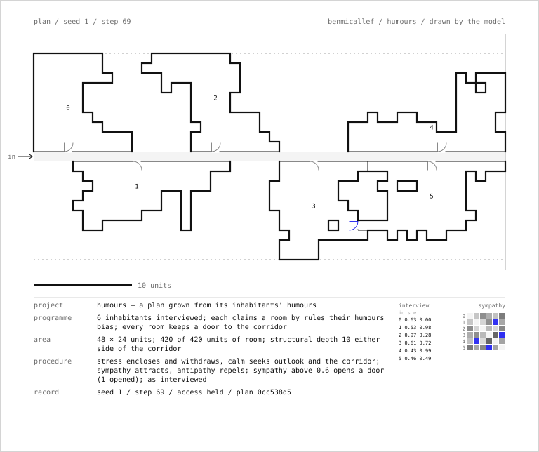
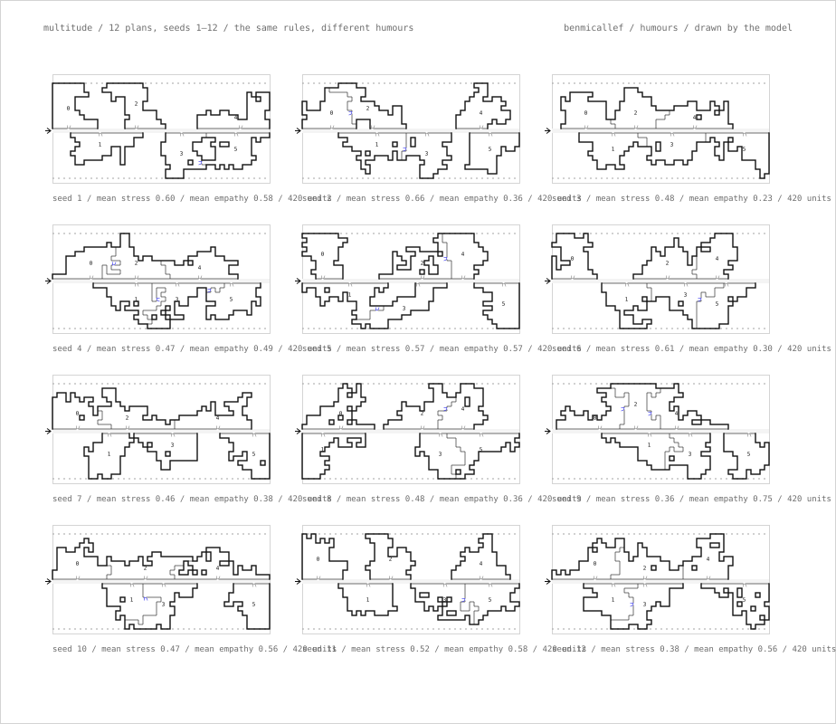

# humours

A dwelling plan grown from its inhabitants' humours. An original homage to R&Sie(n)'s *Une architecture des humeurs* (Le Laboratoire, Paris, 2010), whose premise was that a collective residential structure could be the consequence of its future inhabitants' body chemistry, read as moods and run through a procedure.

**[▶ Live](https://benmicallef.github.io/humours/)** — the plan grows while you watch; *export sheet* downloads the drawing with its title block and the interview.

## The premise

*Une architecture des humeurs* opened at Le Laboratoire, Paris, on 22 January 2010 (the press text closes it on 26 April; the CCA's record says May). R&Sie(n) — François Roche and Stéphanie Lavaux, with Toshikatsu Kiuchi — proposed a conceptual, unbuilt residential structure for a future in which science reads human physiology and chemical balance. Visitors' neuro-biological emissions were scanned on entry, in what the practice later called a physiological interview, and interpreted as temperaments after the four humours; situations of repulsion, stress and pleasure were the inputs from which housing units were conceived; the mathematician François Jouve worked out the structural strategies, under the practice's heading of mathematical operators for structural optimisation; and the components were to be secreted by Viab02, a secretion-and-weaving machine extruding bio-cement, a mix of cement and bio-resin. Robotics Stephan Henrich; computation Marc Fornes, Winston Hampel and Natanel Elfassy; physiological interview Candice Poitrey. The CCA's description of the project says its layouts rearticulate the links between the individual and the collective, and names sympathy and empathy as the terms.

## The model

A 2-D plan on a grid ([`docs/humours.js`](docs/humours.js)). A corridor runs the width of the plan, entered from the left. Each inhabitant seeds one cell on the corridor's flank and claims a room from there.

- **The interview, as numbers.** Each inhabitant has a stress (calm is its complement) and an empathy, and every pair has a symmetric sympathy. All of it is drawn from the seed; the model reads no one.
- **Growth.** Each step, every inhabitant scores the empty cells adjacent to their room and draws one by softmax. Everyone grows compactly, a cell with more sides on its own room scoring higher. Stress raises that and adds a preference for depth, away from the corridor; calm prefers outlook, sides on open ground, and the corridor's edge. Sympathy acts at a distance: a room grows toward the rooms its inhabitant is sympathetic to and away from those they are not, sympathy below one half repelling. Empathy raises the appetite for contact with any neighbour at all.
- **A stand-in for structure.** No room cell may lie further than a fixed depth from the corridor. Every room stays 4-connected by construction and keeps at least one cell on the corridor, so access holds after every step. The plan finishes when the area budget is spent: a finite material, a finished drawing.
- **Doors** are read off the plan and change nothing in it: one per room to the corridor, at the corridor-facing cell nearest the room's centre; one between any two touching rooms whose sympathy is above the openness threshold.
- **Determinism.** Same seed, same interview, same plan. The uncertainty is in the form.

The output is a drawing. **Export sheet** on the live page, and `node tools/sheet.js [seed]`, draw the plan on an SVG sheet — walls, doors with their swings, the corridor and its entrance, the structural depth, a scale bar — with a title block in the scenario format R&Sie(n) used for every project (programme, area, procedure, record) and the interview beside it as a table and a sympathy matrix. That is the sense in which this is a generative architecture.



The practice called the aggregate of such habitats a multitude. `node tools/multitude.js [count] [firstSeed]` draws a contact sheet of plans from as many interviews: the same rules, different humours.



## Tests

```bash
npm test   # node --test, zero dependencies
```

[`test/humours.test.js`](test/humours.test.js) pins properties of this code, never claims about the 2010 project: **access holds after every step across ten seeds** (every room connected and on the corridor); the plan finishes at its area budget with no cell beyond the structural depth; rooms never overlap and the corridor is never built on; determinism; **stress encloses** (a stressed room ends less exposed than a calm one, same empathy, no sympathy); **sympathy attracts and antipathy repels** (a room ends nearer the room it likes than the one it does not, over ten seeds); doors (one to the corridor per room, one between rooms only above the openness threshold); and the sheet.

## What it is not

Not the 2010 project, its mathematics, its chemistry or its machine. Jouve's structural optimisation is replaced by a depth limit on a grid; the physiological interview by seeded numbers; the secreting machine by nothing. The practice's humours were readings of real bodies; these read no one, and the plan makes no claim about how people should live. "Humours", "stress", "repulsion", "sympathy" and "empathy" are the project's own terms, used here with that attribution; the scoring that carries them is mine.

## Why this sits with the rest

In [viab](https://github.com/benmicallef/viab) the humours are a signal that leans a swarm; here they are the inhabitants' own states, and the form is their consequence. Pask argued in 1969 that a building could be a system in conversation with its occupants; R&Sie(n) put the occupants' chemistry on the input side before a wall existed. Both are the cybernetic question the rest of these repositories ask of small machines: what comes out of a loop, run under rules, that nobody drew.

## Sources

- Canadian Centre for Architecture, R&Sie(n) project records, *Une architecture des humeurs* (series dated 2008–2011): [cca.qc.ca](https://www.cca.qc.ca/en/archives/464863/rsien-project-records/500305/une-architecture-des-humeurs).
- R&Sie(n), *an architecture "des humeurs"*, the practice's project text at new-territories.com/blog (posts 106 and 127), 2010.
- The exhibition's press text (January 2010) and the practice's September 2010 text, as reproduced on the architecture blog *boiteaoutils*.
- Gordon Pask, "The Architectural Relevance of Cybernetics", *Architectural Design*, September 1969.

## License

MIT — see [`LICENSE`](LICENSE).
